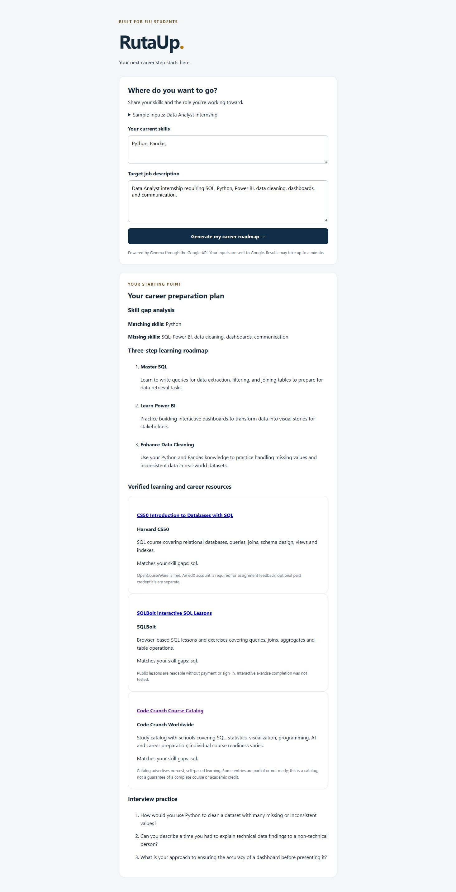

# RutaUp

### Your Skills. Your Path. Your Future.

An FIU-first career readiness assistant that turns a student's skills and a target job description into a practical preparation plan.


[Quick start](#quick-start-windows) · [Demo](#try-the-demo) · [Architecture](#how-it-works) · [Verification](#testing-and-verification) · [Team](#team)

## The problem

Students can recognize an exciting internship without knowing how their current skills compare with its requirements—or which learning resources deserve their limited time. Job descriptions, courses, career services, and interview advice are often scattered across different sites.

## Our solution

RutaUp brings that preparation into one flow: enter current skills, paste a target job description, and receive a focused plan with relevant learning links.

| Working MVP feature | What the student receives |
| --- | --- |
| **Skill-gap analysis** | Matching and missing skills relative to the target role |
| **Personalized learning roadmap** | Exactly three practical steps, each with a title and description |
| **Curated learning and career resources** | Relevant verified HTTPS links, provider details, explanations, and access conditions |
| **Interview practice** | Exactly three questions tailored to the role |

**Model versus API:** RutaUp uses the **Gemma 4 model `gemma-4-26b-a4b-it`**, accessed through Google's **Gemini API** using the Google GenAI SDK. Gemini API is the access service; RutaUp is **not using a Gemini-family model**.

Gemma generates the analysis, three-step roadmap, and interview questions. Python selects resource links from the local catalog. There are no AI-invented resource URLs or canned responses substituted when the model fails.

## Screenshot

<details>
<summary>View the real Gemma-powered browser demo</summary>



Captured during live verification on October 30, 2026. This is an actual application screenshot, taken before the roadmap.sh resources were added. It shows the browser run with the shorter skills input “Python, Pandas,”; the separate JSON-route verification used the full Data Analyst sample.

</details>

## Quick start (Windows)

**Prerequisites:** Git, Python 3.12 or newer, [uv](https://docs.astral.sh/uv/), and a Google API key with access to the configured Gemma 4 model.

In PowerShell:

```powershell
git clone https://github.com/Nic0cava/RutaUp.git
Set-Location RutaUp
uv sync
```

If you already have a checkout, open PowerShell in that project's root instead of cloning again.

### Configure the API safely

Create a file named `.env` in the project root, beside `pyproject.toml`. Enter your key privately in your editor:

```dotenv
GEMINI_API_KEY=replace_with_your_own_key
GEMINI_MODEL=gemma-4-26b-a4b-it
```

| Variable | Purpose |
| --- | --- |
| `GEMINI_API_KEY` | Required Google API credential; kept server-side |
| `GEMINI_MODEL` | Optional; defaults to `gemma-4-26b-a4b-it`. Overrides must identify a Gemma 4 model available to your account. |

- `.env` is Git-ignored. Confirm with `git check-ignore .env`.
- Never commit a key, paste it into an issue, or include it in a screenshot or recording.
- Process environment variables can be used instead of a file and take precedence over values loaded from `.env`.
- Each Git worktree needs its own local configuration; a sibling worktree's `.env` is not read.
- Restart the application after changing configuration.

### Launch

```powershell
uv run uvicorn backend.main:app --reload
```

Open **[http://127.0.0.1:8000](http://127.0.0.1:8000)**. FastAPI serves both the frontend and API; no separate frontend server is needed. Press **Ctrl+C** to stop.

Submitting an analysis sends the entered skills and job description to Google. The page shows loading feedback while the request runs; responses may take up to a minute. Missing credentials, provider failures, and invalid model responses produce controlled error messages.

## Try the demo

Use the labeled sample inputs on the page, or try this fuller example:

**Current skills**
```text
Python, Pandas, Excel, basic data visualization.
```

**Target job description**
```text
Data Analyst internship requiring SQL, Python, Power BI, data cleaning, dashboards, and communication.
```

Select **Generate my career roadmap**. Results appear in four sections; resource links open separately and include their access conditions. Generated answers can vary between runs.

## How it works

```text
Skills + target job
        |
FastAPI input validation
        |
Gemma 4 via Gemini API
        |
JSON parsing + Pydantic validation
        |
Catalog matching from missing skills + supported target role
        |
Jinja2 results page or JSON API response
```

| Component | Implementation |
| --- | --- |
| Backend | Python, FastAPI, and Uvicorn; one shared analysis function for HTML and JSON routes |
| Frontend | Jinja2-rendered HTML, CSS, and a small JavaScript loading indicator |
| AI integration | Google GenAI SDK; JSON requested through the prompt and validated locally |
| Response validation | Pydantic validates required fields, nonblank strings, exactly three roadmap objects, and exactly three questions |
| Resources | Local JSON catalog and dependency-free deterministic Python matcher |
| Development | uv environment and lockfile; standard-library unittest with a mocked Google SDK for offline tests |

### Resource matching

The catalog contains **12 resources**, including four roadmap.sh guides: Data Analyst, SQL, Python, and Power BI.

Matching normalizes skill names and common synonyms. Ranking considers matching skill count plus an explicit role match, prefers specific resources over broad catalogs, then applies FIU preference and deterministic ordering. Duplicate URLs, malformed entries, unverified records, and non-HTTPS links are excluded.

An explicit **Data Analyst** title at the start of the job description can select the role roadmap. Supported title forms include `Junior Data Analyst` and `Target role: Data Analyst`. Incidental mentions of another team's role do not trigger it. This is deliberately limited matching, not general job-title understanding.

roadmap.sh links supplement Gemma's personalized three-step plan; they do not replace it or cause another AI request. If nothing matches, the interface displays **“No curated resource match yet.”**

“Verified” records identify a checked URL and description, with a verification date and note. It does **not** mean every linked course is complete, every event is free, or every service is open to everyone. Public roadmaps can link to paid courses; FIU services may require eligibility; account and certificate requirements vary.

### API

| Endpoint | Purpose |
| --- | --- |
| `GET /` | Student input form |
| `POST /analyze` | Form submission and rendered results |
| `POST /api/analyze` | JSON analysis request and response |
| `GET /api/health` | Health check without a model request |
| `GET /docs` | Interactive API documentation |

Both analysis routes accept `skills` and `job_description`. The result contains `matching_skills`, `missing_skills`, `roadmap`, `interview_questions`, and `resources`. Input failures return HTTP 422; controlled model, configuration, and resource-loading errors return HTTP 502.

### Project layout

```text
backend/
  main.py                  # Routes and shared analysis pipeline
  ai.py                    # Gemma request, JSON parsing, and validation
  resources.json           # Curated resource catalog
  resource_matcher.py      # Skill and role matching
  test_resource_matcher.py # Catalog and ranking tests
  test_ai.py               # Mocked connector and validation tests
  test_api.py              # Route and HTML rendering tests
frontend/
  index.html               # Form and four result sections
  styles.css               # Visual styling
  loading.js               # Loading feedback
docs/screenshots/
  rutaup-live-verification.png
pyproject.toml
uv.lock
```

## Testing and verification

**Recorded verification on October 30, 2026:**

| Check | Recorded result |
| --- | --- |
| Final offline suite after roadmap.sh addition | **53 tests passed** |
| Earlier integrated MVP suite | **46 tests passed** |
| Real Gemma 4 requests | **Two successful requests**, through JSON and HTML flows |
| Browser inspection | All four result sections rendered; screenshot above |
| Final application startup | Homepage, health endpoint, API docs, CSS, and JavaScript served successfully |
| Resource checks | Catalog-only HTTPS URLs, matching, deduplication, and FIU preference tested |

The live requests and browser capture preceded the roadmap.sh addition. The addition passed offline tests and startup checks without further model requests. These are recorded results, not a continuous-integration badge or a claim that tests were rerun for this README edit.

Run the full offline suite from the project root:

```powershell
uv run python -B -m unittest backend.test_resource_matcher backend.test_ai backend.test_api -v
git diff --check
```

Tests cover malformed/missing AI fields, incorrect counts, empty inputs, missing keys, provider failures, safe HTML escaping, resource ranking, role matching, duplicate URLs, and empty results. The Google SDK is mocked: the suite makes **no live model requests** and does not require a real API key.

The tested environment emitted a non-blocking Starlette/httpx deprecation warning; all tests passed.

## Team

| Developer | Contributions |
| --- | --- |
| **Oliver Hernandez** | Curated resource library, deterministic recommendations, and resource matching tests |
| **Nicolas Cava** | Gemma integration and the FastAPI/frontend foundation |

## Resource providers and acknowledgments

The catalog links to [FIU Career and Talent Development](https://career.fiu.edu/), [ColorStack at FIU](https://colorstackatfiu.vercel.app/), [Google Developer Group at FIU](https://gdgatfiu.vercel.app/), [Code Crunch Worldwide](https://codecrunchglobal.vercel.app/courses), [SQLBolt](https://sqlbolt.com/), Harvard CS50's [Python](https://cs50.harvard.edu/python/), [AI](https://cs50.harvard.edu/ai/), and [SQL](https://cs50.harvard.edu/sql/) courses, and [roadmap.sh](https://roadmap.sh/).

Hack University was considered as a community source; its resource page was excluded when it could not be verified. Model inference uses Google Gemma 4 through the Gemini API and Google GenAI SDK.

RutaUp is an independent student hackathon project. References to FIU, Google, student organizations, or other providers do not imply official affiliation, sponsorship, or endorsement.

## Limitations and next steps

- AI output can contain unsupported inferences. Validation checks structure, not factual accuracy or career outcomes.
- The catalog and synonym map are small. Role detection currently supports explicit Data Analyst titles, and availability may change after a link is checked.
- Access depends on model availability, network conditions, and API quota. There is no synthetic fallback for failed analysis.
- This prototype has no accounts, database, resume uploads, or exports.

Future work could expand verified resources and role coverage, improve handling of uncertain skill inferences, add scheduled link checks, and collect student feedback on recommendation usefulness. These improvements are not implemented in the submitted MVP.
